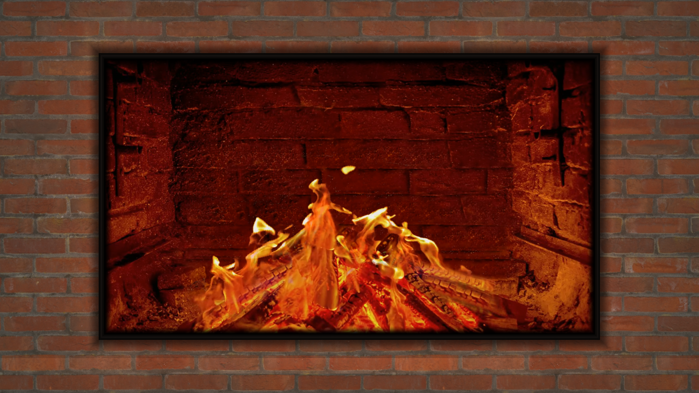
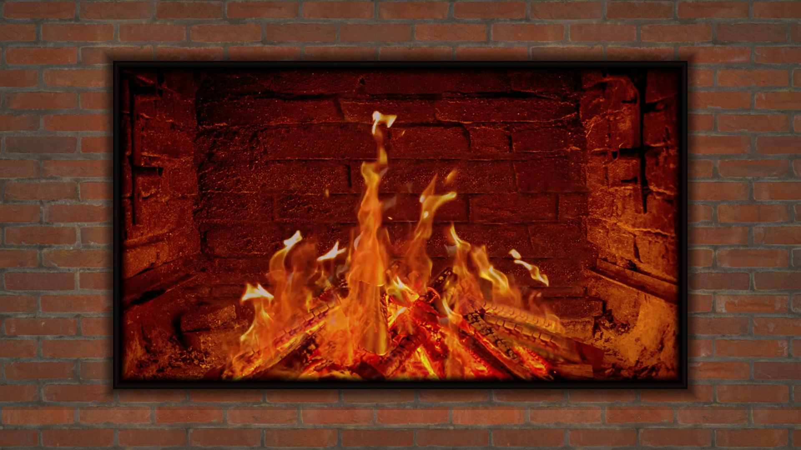
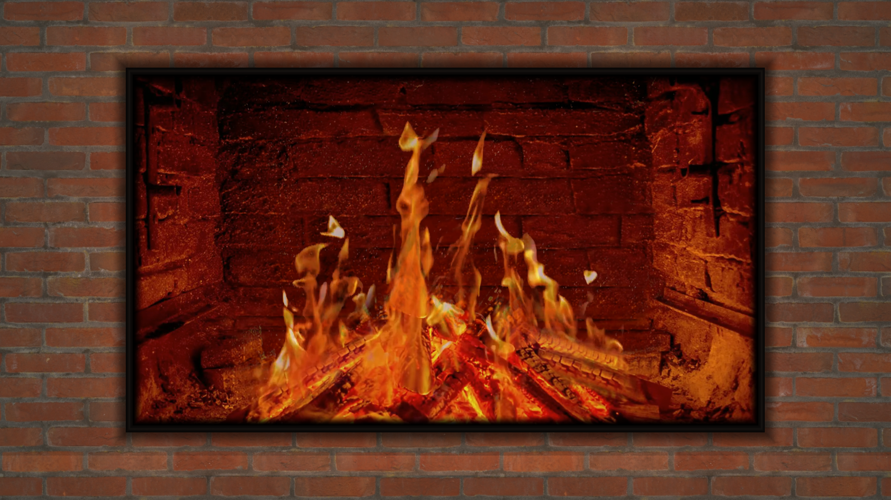
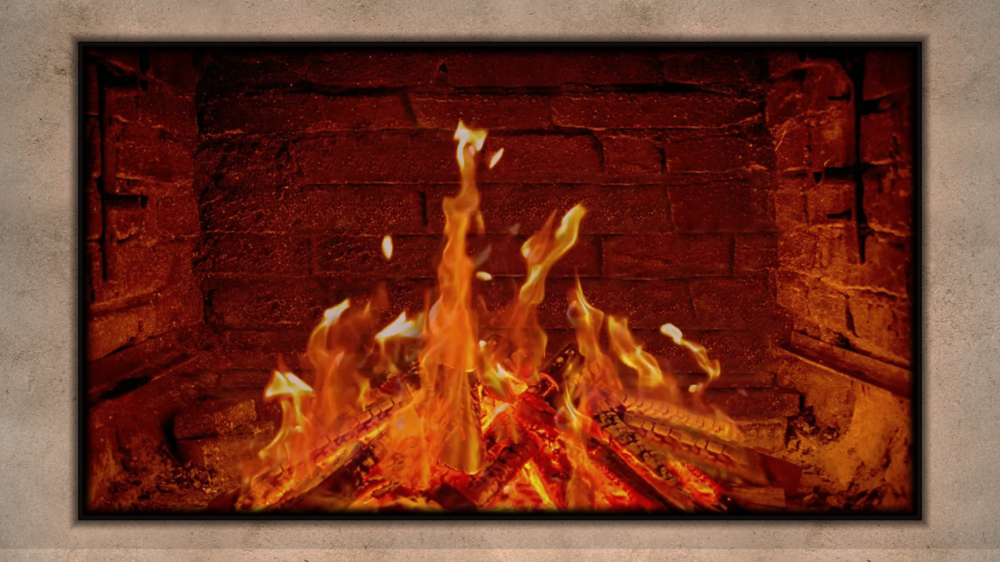
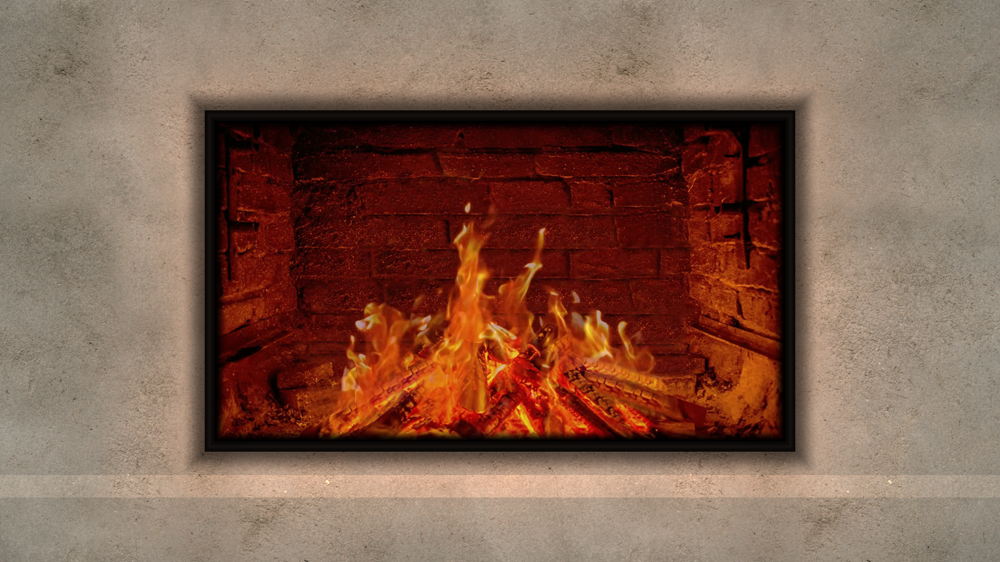
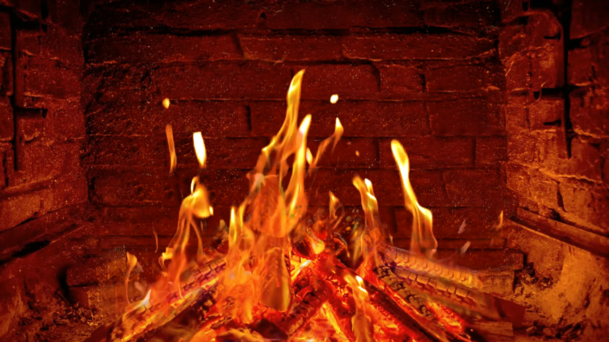
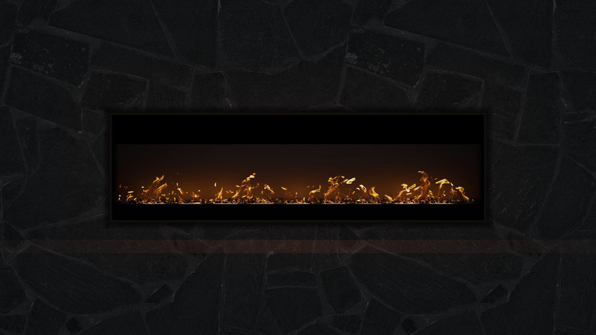
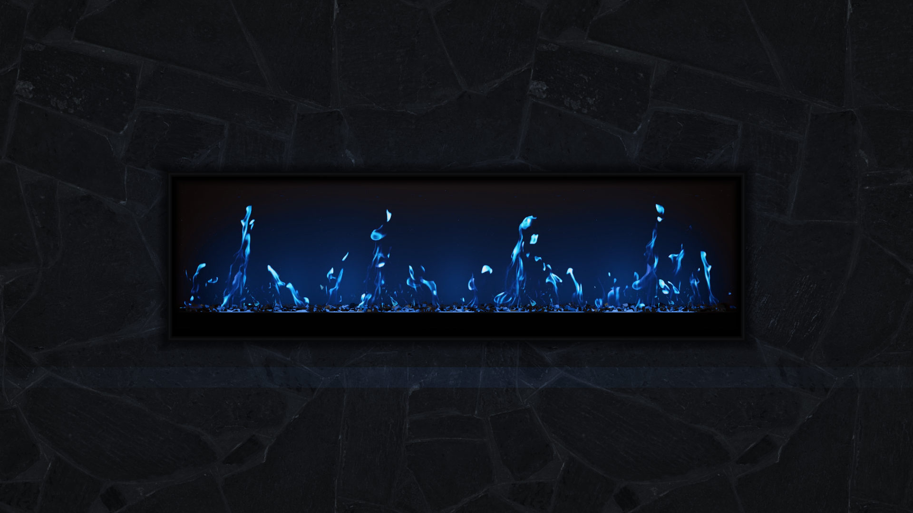
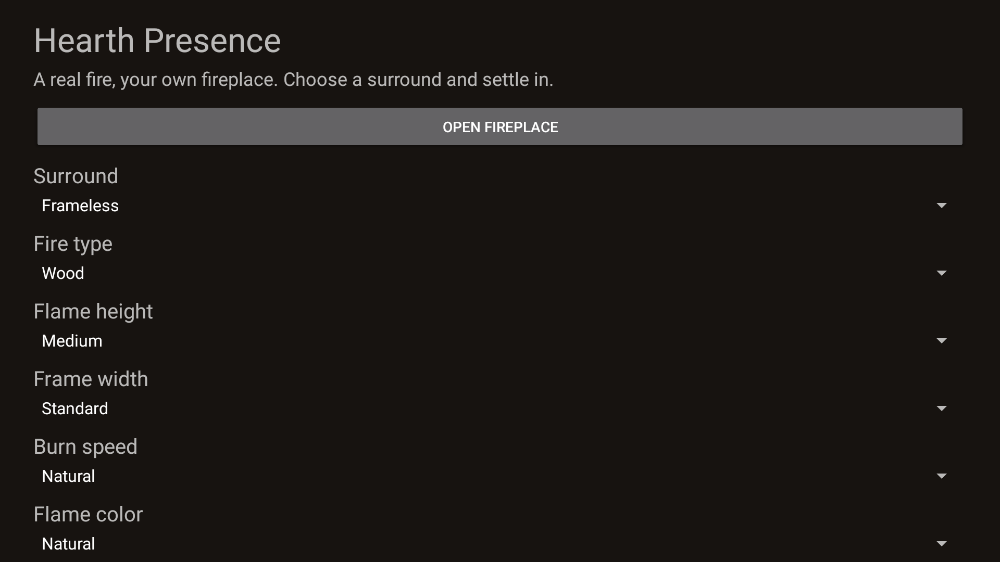

# Native screenshots

## Current 1.1.0 physical captures

All nine images show the exact signed version 1.1.0/code 7 APK on
AFTDEC012E/API 30 at 1920x1080. The frameless capture is from the naturally
bound, non-test DreamService; the remaining images show Preview or Settings.
All were visually inspected before inclusion. [Capture hashes and routes](../art/screenshots/physical7-provenance.json)
identify the current artifact. Small and Large wood variants adapt recorded flame
emission at 1080p/30 while keeping the logs and walls fixed. Linear fire remains
a composite depiction, not photographed gas. See [verification](VERIFICATION.md)
for clean presentation sampling and limitations.

<table><tr><td> Small wood height</td><td> Original medium wood fire</td><td> Large wood height</td></tr><tr><td> Thin white frame</td><td> Wide white frame</td><td> Frameless Large normal Dream</td></tr><tr><td> Small natural linear composite</td><td> Large blue linear composite</td><td> Native remote settings</td></tr></table>

## Earlier code 7 emulator evidence

The four API 34 captures remain available in the repository and are tied to
[their provenance](../art/screenshots/wood-height-provenance.json). Independent
normal-speed review played the 34.685-second native movie across its source
period. This does not establish frame-by-frame seam verification or owner
acceptance.

## Released 1.0.0 modes

The following captures document the earlier released build and its available
controls. They are historical evidence, not current code 7 appearance or
performance tests; the current captures above take precedence.

Captured from the running native application. The first two images show the exact final production APK on a physical AFTDEC012E Fire TV; the third shows its unchanged modern scene through the actual DreamService on API 34. Remaining captures show the verified emulator controls and materials. Footage attribution is in [NOTICE](../NOTICE).

<table><tr><td></td><td></td><td></td></tr><tr><td></td><td></td><td></td></tr><tr><td></td><td></td><td></td></tr><tr><td></td><td></td><td></td></tr><tr><td></td><td></td><td></td></tr><tr><td></td><td></td><td></td></tr></table>
